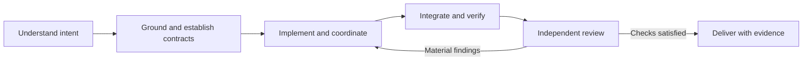

<p align="center">
  
</p>

# Reefstack

**Engineering flow without the ritual.**

[](https://github.com/thetylerreiff/reefstack/actions/workflows/checks.yml)
[](LICENSE)

Reefstack gives Codex an engineering workflow as a set of skills. You describe the outcome in ordinary conversation. It chooses how much preparation, delegation, verification, and review the task deserves.

An obvious header-color fix gets a direct edit and a focused check. A substantial feature gets shared contracts, coordinated implementation, integration checks, and fresh independent review. You don't choose a mode or remember which skill comes next, though a turn that doesn't match the coordinator's description may run without it unless your `AGENTS.md` names it (see [triggering](#triggering)).

The objective is fast delivery with correctness and maintainability preserved. That is a design goal, not a benchmark claim.

## Install

Reefstack is a set of skills: Markdown procedures plus one standard-library Python lint used by the `map` and `verify` skills. It has no hooks, settings, or background processes. Install one copy; two installs list every skill twice.

**As skills (recommended).** Link the skill folders into Codex's user skills directory, keeping them siblings:

```sh
git clone https://github.com/thetylerreiff/reefstack.git ~/Developer/reefstack
mkdir -p ~/.agents/skills
for skill in ~/Developer/reefstack/skills/*; do ln -s "$skill" ~/.agents/skills/; done
```

`git pull` updates them in place. Codex follows the links to this checkout and names the skills after its plugin manifest, so the coordinator is `$reefstack:reefstack`; copied folders (`cp -R`) are named plainly, as `$reefstack`, but need recopying to update.

**As a plugin.** Add this repository as a marketplace and install it; the coordinator is then `$reefstack:reefstack`:

```sh
codex plugin marketplace add thetylerreiff/reefstack
codex plugin add reefstack@reefstack
```

**For one repository or cloud tasks.** A cloud task sees only the repository it runs on, not your local skills or plugins. Copy the skill folders into that repository's `.agents/skills/` and commit them; the coordinator is then `$reefstack`.

### Triggering

Use normal requests:

> Change the header color to pink.

> Figure out why retrying the export creates duplicate rows. Don't change code yet.

> Build the import pipeline with validation, persistence, and progress reporting.

Codex uses a skill when a turn names it or the task clearly matches its description, and does not carry it to later turns unless it is named again. The coordinator's description lists the engineering tasks it covers, so most first requests should match; a follow-up like "looks good, go ahead" may not. To keep it on every turn of a task, add one line to `~/.codex/AGENTS.md` or a repository's `AGENTS.md`. Codex loads instruction files on every turn; whether that holds for heartbeat turns and cloud tasks is untested:

```text
For software engineering work, use the reefstack skill.
```

Scheduled prompts, such as PR watches, name the coordinator explicitly. Watches created by 0.3.x or earlier lack that line, and 0.2.x ones point at removed `.reefstack/tasks/` records: recreate them. `codex debug prompt-input "<request>"` shows which skills a directory actually loads. Triggering on each surface is not yet measured; see [verification](#verification).

### Supported surfaces

The skills use the standard `SKILL.md` format, so any host that loads skill folders can read them. Codex delegation and PR-watch mechanics are in `skills/reefstack/harness/`; other hosts need their own equivalents, which are not implemented or validated here.

## How it works

The main agent owns intent, difficult boundaries, the critical path, integration, and the final result. Helpers handle independent work when the delegation triggers apply.

| Work | Expected depth |
| --- | --- |
| Small, known local change | Direct edit and a focused check. No design exercise, delegation, or required independent review. |
| Routine bounded change | Relevant inspection, targeted checks, and a light fresh review of the intended case and callers. |
| Substantial or consequential change | Proved contracts, coordinated implementation, behavioral integration checks, and a full fresh review aimed at the fact the change is safe because of. |
| Any change you ask to make quick | Focused checks only, with no reviewer or extra procedure. Claims still carry evidence or a gap. |

Depth depends on coupling, uncertainty, impact, and verification needs. File count and the word *feature* do not decide it. A one-line permission change can deserve more scrutiny than a large mechanical edit.

When substantial or consequential work still depends on an unresolved product choice, Reefstack pressure-tests the problem and intended outcome before technical design. It also runs when you explicitly ask to be grilled or to pressure-test an idea. The main agent asks one high-value question at a time, researches facts that can be established from available sources, and offers simpler alternatives when useful. It stops when there is a decision-ready brief covering the problem, outcome, constraints, non-goals, success criteria, and remaining assumptions. Clear requirements and small edits skip this step. The brief clarifies the work; it does not authorize implementation or expand the user's original request.



These are responsibilities, not mandatory serial steps. Independent reads, implementation, and checks can overlap. Uncertain shared contracts are resolved before dependent workers start. Repeated correctness failures return to the main agent for investigation rather than another blind retry. After Codex opens or pushes to a pull request with the coordinator loaded, it attaches the same 10-minute heartbeat as the app's "Watch and fix PR" button, so checks and conflicts the pull request caused are fixed without another prompt. Pause it from the pull request panel. Settings → Git → "Pull request watch instructions" overrides its defaults.

### Compact playbooks

Task type selects the procedure; uncertainty and consequences set the depth. The selected playbook owns the sequence, with outputs and completion checks. Skills supply reusable methods; the harness supplies host mechanics. Use an existing task list when needed, with reasons for skipped steps. Routine work can use a procedure without delegation. Small, obvious edits still go straight to the change and a focused check.

| Task | Playbook |
| --- | --- |
| Explain behavior without changing it | [Investigation](skills/reefstack/references/playbooks/investigation.md) |
| Reproduce and repair a defect | [Bug fix](skills/reefstack/references/playbooks/bug-fix.md) |
| Add or change behavior | [Feature](skills/reefstack/references/playbooks/feature.md) |
| Restructure while preserving behavior | [Refactoring](skills/reefstack/references/playbooks/refactoring.md) |
| Improve a measured performance problem | [Performance](skills/reefstack/references/playbooks/performance.md) |
| Try an approach to inform a decision | [Prototype](skills/reefstack/references/playbooks/prototype.md) |
| Prepare an authorized PR | [Opening a PR](skills/reefstack/references/playbooks/opening-pr.md) |
| Assess, fix, or watch an existing PR | [PR follow-up](skills/reefstack/references/playbooks/pr-follow-up.md) |
| Land an authorized PR or ordered stack | [Shipping](skills/reefstack/references/playbooks/shipping.md) |
| Continue interrupted work or take over someone else's | [Resume](skills/reefstack/references/playbooks/resume.md) |

Refactoring pins existing behavior; performance work compares reproducible measurements; prototypes remain experimental until production work is authorized. PR follow-up owns Check, Fix, and Watch policy; its harness only schedules bounded passes. Watch alone is observation-only, while authorized PR creation or pushes default to repair monitoring unless narrowed. Paused watches stay paused without a resumption request. Completing local work does not automatically open a PR, a status request remains read-only, and permission to open or fix a PR does not authorize merging or deployment.

The [resume playbook](skills/reefstack/references/playbooks/resume.md) picks up interrupted work, or someone else's branch, PR, or thread, from current files, Git state, and any plan or handoff note. It treats the handoff as context, not proof, and rechecks inherited claims before relying on them. Reefstack keeps no task state of its own.

Routine or larger changes to a UI, CLI, or API are proven by using the running app: a browser for web apps, real commands for CLIs, real requests for APIs, a simulator for mobile. Each changed path is reported as verified, unreachable, blocked, or not tried, with screenshots, command output, or saved responses; only verified counts as a pass. Trivial edits don't launch anything. Ask to "set up a way for agents to test this app" and Reefstack writes a feature map in `docs/verification/`, lints it, and tries one entry for real; later changes use the map and keep it current when an entry point moves.

Discussion, planning, diagnosis, and review remain read-only unless you authorize changes. Reefstack does not grant permission to deploy, alter shared data, contact people, or expand the task.

## Skills

The skill names organize the implementation. They are not a vocabulary you need to learn.

| Skill | Responsibility |
| --- | --- |
| `reefstack` | Intent, task depth, routing, coordination, and completion. |
| `grill` | Pressure-test the problem and intended outcome when unresolved human choices could materially change substantial or consequential work. |
| `ground` | Relevant source, existing patterns, and uncertain integration facts. |
| `design` | Caller-first contracts, ownership, fixtures, and acceptance criteria. |
| `deliver` | Implementation, useful delegation, and continuous integration. |
| `diagnose` | Reproduction, hypotheses, root cause, and regression checks. |
| `verify` | Behavioral proof, driving the running app for user-facing changes, revision-specific evidence, and coverage gaps. |
| `map` | On request, a per-feature verification map in `docs/verification/` that tells agents how to reach and check each feature. |
| `review` | Fresh scrutiny, material findings, and rechecking accepted fixes. |
| `setup` | Installation, triggering repair, and onboarding. |

### Settings

The main agent keeps the model and reasoning effort selected in your chat, and chooses helpers' models and effort for the work. Reefstack names no models.

Reefstack has no settings file. To turn it off, remove the linked skill folders or disable the plugin.

## Architecture

- **Skills:** everything that ships is under `skills/`. The coordinator `skills/reefstack/` holds the playbooks and shared references in `references/` and the Codex install, delegation, and PR-watch mechanics in `harness/`. Links under `skills/` stay inside it, so the folders install on their own.
- **Feature map lint:** `skills/map/scripts/map_lint.py [docs/verification] [--since <base>]` checks a map's shape (required sections, typed non-empty entry points, an index with no missing or dead entries) and, with `--since`, flags entries whose route, command, or label the change removed from the source.
- **Development tooling:** `scripts/health.py`, `scripts/playbook_lint.py`, `scripts/package.py`, and `tests/` check the repository; none of them run when the skills are used.
- **Evaluations:** `scripts/run_evals.py` runs blind cases against sample apps in `evaluations/fixtures/` and has a judge from a different model family score them; see [the playbook](evaluations/playbook.md).
- **Failure log:** `docs/failure-log.md` records observed failures and the check, skill change, or map fix each became; [enforcement](skills/reefstack/references/enforcement.md) says when a repeat becomes a check.
- **Distribution:** `.codex-plugin/plugin.json` is the Codex manifest and lists only the skills; `.agents/plugins/marketplace.json` makes this repository installable as a marketplace.

Version 0.4.0 removed the `SessionStart` and `SubagentStart` hooks and their Python adapter. Standing guidance now lives in the coordinator skill, delegated-work limits in the worker brief, and per-turn activation in the skill description or an `AGENTS.md` line.

## Verification

Run local checks from the repository root:

```sh
python3 scripts/health.py
python3 -m unittest discover -s tests -v
```

Health also lints the packaged feature-map template and this repository's own `docs/verification/` if one exists; run `skills/map/scripts/map_lint.py <path>` to lint a project's map. The lint and the tests use the Python standard library. CI runs package health and tests, creates a standalone ZIP, and verifies its extracted contents.

The health report separates package validity from installation and behavioral acceptance. A valid package is not proof that a host loaded the skills or that they trigger.

After installation, exercise the ordinary requests in [evaluations/cases.json](evaluations/cases.json) and inspect actual actions. The runnable cases can be run end to end with `python3 scripts/run_evals.py` and an agent CLI plus a judge API key; [the playbook](evaluations/playbook.md) covers setup, blinding, reading results, and the stopping rule. `python3 scripts/run_evals.py --check` validates the cases without model calls. Small edits should stay small. Discussion-only requests should stay read-only. A substantial change should receive integration checks and a fresh reviewer. Repeat in a later turn, after compaction, in a scheduled heartbeat turn, and in a cloud task, and verify removal in a fresh chat.

[VERIFICATION.md](VERIFICATION.md) records current checks and remaining gaps. There is no completed comparison establishing speed improvements over a single-agent workflow or PStack.

## Build a plugin archive

```sh
python3 scripts/package.py --output ../reefstack-plugin.zip
```

The archive contains one top-level `reefstack/` plugin directory with its icon, manifest, skills, and development files. It excludes Git history, CI configuration, the marketplace, caches, and local configuration. The builder refuses to overwrite an existing file.

## Update or remove

A skills-folder install updates with `git pull` in the checkout. A plugin install updates through Codex's plugin interface; Codex can load a cached copy, so check the installed version after an update. Upgrading a plugin install from 0.3.x removes its hooks; any hook trust entries left in `~/.codex/config.toml` are inert.

Remove the linked folders from `~/.agents/skills/`, or use Codex's plugin controls, and verify in a fresh chat. Skills already loaded into an open conversation stay there until it ends. Reefstack does not register global agent profiles or edit global instruction files.

## Contributing

Contributions that improve real routing, integration proof, or verification are welcome. Include a realistic request or failing check that demonstrates the problem. Prefer a focused correction over another universal instruction.

See [CONTRIBUTING.md](CONTRIBUTING.md) for the development and review workflow.

## Credits and license

Inspired by [Lauren Tan's PStack](https://github.com/cursor/plugins/tree/main/pstack): caller-first contracts, clear ownership, verification on the actual artifact, independent scrutiny, and reusable tooling. Reefstack is an original implementation and is not affiliated with PStack or OpenAI.

The coral icon was generated with ImageGen. Its prompt is preserved in [assets/icon-prompt.txt](assets/icon-prompt.txt).

[MIT](LICENSE) © 2026 Tyler Reiff.
